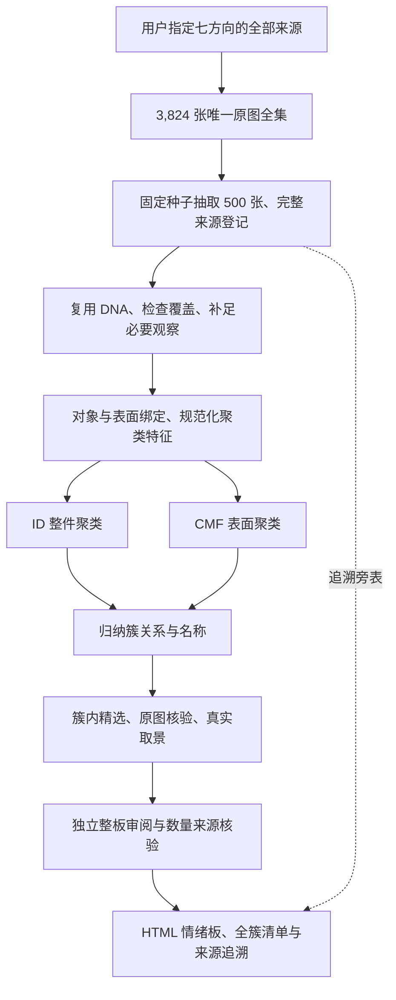

# 混合图片子库 → DNA 聚类 → ID / CMF 情绪板：新 Skill 设计建议

日期：2026-10-09（Asia/Shanghai）。状态：**已按用户修订创建独立 Skill，执行 500 图抽样试跑；后续状态见 docs/PROGRESS.md。**

用户最新覆盖：取消 Top 5；以旧七方向涵盖的 3,824 张唯一原图为全集，先随机抽取 500 张；每板 6–10 张，优先 8 张及以上，6–7 张可接受。运行中允许依据实际问题优化 Skill，保留历史与修订原因。

需求来源：[设计师反馈与流程调整备忘](../ref/设计师反馈与流程调整备忘_20261009.html)。本文结合当前代码与现存数据检查，把备忘进一步落实到输入合同、算法边界和可验证的改动；建议参数不代表已批准或已测出的最优配置。

## 1. 建议的职责与流程

新增独立入口 **`prism-dna-cluster-moodboard`**，服务“语义圈定范围后，按图像 DNA 发现视觉簇并交付情绪板”。旧流程继续按原版本保留。新入口内部组织取池、特征适配、聚类、选板与审阅，不需要为每个内部步骤再建立一个 Skill。

核心变化是：**高潜趋势决定观察哪些图片；图片 DNA 决定哪些图属于同一视觉簇；簇形成后才归纳名称。**

所有相关图片都进入处理台账；最后的情绪板只展示有代表性且通过当前核验的成员。输入方向数不等于视觉簇数或板数，也不预设 ID / CMF 各几张。一张图可以提供 ID 单元及多个真实 CMF 表面单元，某条分支证据不足不妨碍另一条分支处理。

## 2. 当前输入存在的实际问题

### 2.1 使用已指定全集，不再要求排名

用户已明确取消 Top 5。新 Skill 直接使用 [selection.json](../data/result/semantic_handshake/sol61_native_v2_20261006/h01-run/selection.json) 中旧七方向所关联的完整原图全集，3,824 个唯一 SHA；方向只负责来源联接，不作为风格或分支限制。

当前旧 H01 的 9 个候选没有显式 rank，此事实不再阻挡本任务，也无需为了运行新路线重新做高潜排名。历史七方向中的 ID / CMF 选择同样不限制当前图片进入哪条分支。

抽样按 `SHA256("20261009:" + 原图SHA)` 排序取前 500，固定种子且不按已有 DNA、旧品质、风格或品类预筛。其余 3,324 图保留全集台账，本次不自动扩展模型运行。

### 2.2 全部相关图片必须从文章完整关联展开

应使用 [related-trend-articles.json](../data/result/semantic_handshake/sol61_native_v2_20261006/related-trend-articles.json) 中 `articles[].direction_membership` 联接所选方向，再展开每篇的 `images[]`，而不是使用 `candidate_image_ids` 的少量直接引用、旧选材池或最终板图：

| 当前范围（只读统计） | 文章 | 图片引用 | 唯一原图 SHA |
| --- | ---: | ---: | ---: |
| 全部 9 个 H01 候选的来源目录 | 591 | 4,241 | 4,209 |
| 旧 7 个已选方向 | 548 | 3,851 | 3,824 |

上表唯一 SHA 只计有哈希的原图；两个范围均另含 1 条下载失败且无 SHA 的引用。无 SHA 的待处理记录保留原来源／图片 ID，不能把所有空 SHA 合并为一张图。旧七方向的图片数已在本次用现存关联 JSON 独立复算。

9 个候选的 `candidate_image_ids` 并集只有 142 个，不能代表全部相关图片。原 210 张预览工作池、后续候选池及最终 56 个展示位同样不是新流程的全集。**本次采用表中旧七方向的 3,824 个唯一 SHA 为全集，实际模型范围为其中固定抽出的 500 图。**

合并时以原图 SHA 去重，保留所有 `image_id / image_url / article_id / article_url / direction_id` 关联与本地路径；同 URL 不必然同字节，同字节的多个来源不能丢失。保留多角度图片，项目支持数和最终板数则按实际项目去重，不能让同一项目的十个角度成为十份独立支持。

图片 URL 使用图片记录的 `url / download_url / resolved_url` 并标明用途；文章 URL 使用 `metadata.detail_url`。关联表的 `source_url` 可能实际是图片地址，不能不分字段语义直接当文章链接。原文章 ID 不等于已核实项目 ID。

此处默认“相关图片”指明确七方向关联的 H01 趋势文章的全部关联图。当前候选中的用研原文 `image_associations` 为空，不能静默把所有用研图加入。若以后要合入用研图片，应另建有证据的关联规则和来源角色。

### 2.3 已有 DNA 可以大幅复用，但覆盖不等于可靠

现有 [DNA 文本归档](../ref/全部图片DNA结果文本_20261009.zip) 登记 8,872 个原图身份、9,649 份结果版本，其中当前 R5 关联 8,464 张图。历史多标签、R17 与 R5 不属于同一个字段和提取协议。

对旧七方向的 3,824 个唯一 SHA，轻量索引关联可找到 **3,506 张的 R5**，另 **318 张待处理**，此外还有上一节所述的 1 条无原图失败引用。前者包含 completed 和 partial，仅说明有结果可读取，不证明本方案的关键字段完整或正确。此统计是全集的已有结果覆盖，不是抽样后的本轮视觉通过率。

上述关联使用 [旧全库 inventory](../data/result/visual_workflow/h01_all13_20261005_expanded/inventory.json) 与 [10 月 7 日实际补提目录](../data/result/visual_completion/sol61_high_20261007/new-dna/)，按图像 SHA 合并有出处的落盘结果。旧 `new-dna-index.json` 未包含后来成功落盘的一份结果，因此不能单凭旧索引计数；也不能把历史 Gemini / Sol 结果统一改标为当前模型。

优先按原图 SHA、提取规则／Prompt 版本、范围及实际生产者读取旧结果，建立本轮覆盖台账。缺失、失败、pending、不可读均单列；不同规则的旧结果先做显式字段映射和证据核验，不能仅把编号中的零删掉就认为兼容。

## 2.4 第二次试跑：主体与整体调性（Skill 0.2.0）

用户查看首次交付后要求：避免次要墙面／背景小区域；允许手机、手表、汽车、衣物、家具等跨品类，但整体颜色或设计及调性协调；优先有设计感的素材。新版保持同一500图样本，在独立 `sample500_subject_v2_20261009/` 运行，保留前版。

新版先定位照片主物品，再观察其整体与主要表面；背景／次要目标无入板资格。局部 `evidence_bbox` 与主体 `display_bbox` 分开，实际展示包含主体上下文。新增 `whole_appearance` 记录主物品整体配色、线条、边缘、细节组织及有可见锚点的轻重／秩序／动静。不同品类的功能轮廓或部件数量不再直接阻断跨品类设计语汇。`design_quality` 记录可见设计处理并用于簇内择优，不按品牌、价格、材质贵贱或简繁判断。

以下首版方案中的整物功能形态和局部 CMF 距离描述属于历史设计依据；当前运行的准确字段、跨块政策与版本以本次脚本和运行合同为准。新字段不自动回填旧观察，初次46候选板与8张视觉支持板的历史结论不被新版覆盖。

## 2.5 追加定义：跨材质的组合设计情绪（Skill 0.3.0）

用户在本轮执行中进一步明确，不同材料可以同板；形态、比例、色彩、材料质感和细节语言组合后的整体感受应相近。相同圆润轮廓配暖浅织物、或配镜面金属和锐利接缝，可能传达不同情绪；各单维允许不同，需解释差异如何协调。因此本版不以材料类别、光泽或纹理单项差异直接拒绝候选。

`design_emotion` 作为有可见五维依据的解释性判断单独保存，不能冒充原始DNA或普遍用户感受。结构化轴形成候选，情绪名称不进入距离；独立板审再看原图和实际板图，说明组合支持和最不协调成员。旧协议已提交60图的结果保留，只对已有主体补缺失情绪；剩余同一样本使用新协议。具体执行与并发由运行目录的 `contract-amendments/design-emotion-v3.json` 保存。

## 2.6 范围修正：同级对象与代表性局部（Skill 0.4.0）

用户允许和主物品同级的其他设计物品，也需要有代表性的局部。0.3完成结果27板的207个展示位都包含所选主体，说明展示整物硬门过强；不是素材不存在可用局部。当前规则改为主／同级对象都可、整体／代表性局部都可，不以画面最大、居中、裁片面积或局部比例做硬门，仍排除只有颜色相似的偶然背景碎片。

新观察v3／Prompt v8在同一张原图内分别绑定所选对象、事实范围、展示范围与取景理由。ID局部只描述可见造型／构造，不冒称整物比例或全部构件；CMF保留同一对象的真实表面关系。不同对象分别保存整体外观与五维组合设计情绪，同一对象的单元保持一致；先提可见事实再解释情绪，不能按想要的情绪反填DNA。原R5提取器及旧字典不变，新增判断是本流程的独立观察／解释层。

新板审v4对照原图核对象资格和组合上下文，再核真实裁片能否表达板的共同关系，且没有隐藏关键冲突。局部不必显露全部五维，但不能只凭单个颜色或情绪同名通过；截图绑定当前对象及实际取景。旧观察和旧PASS不自动升级，换对象／事实范围需定点补查，新裁片重审。本次只更新Skill及小量离线验证，0.3发布页和500图历史产物保持不变。

以下首版建议及2.4／2.5是版本演进记录；与0.4对象／局部范围冲突的整物限制不再适用于新协议，精确合同见当前Skill与版本化脚本。

## 3. DNA 提取需要哪些调整

结论：**需要小幅、版本化优化；主要补状态、范围和关键维度覆盖，不需要推翻现有字典或全库重新提取。**

当前 [R5 Skill](../.agents/skills/prism-dna-sol-r5/SKILL.md) 已坚持只读可见事实、同位置 CMF 共现、未知保留及原始证据追溯，适合作为基础。完整字典 216 项，但当前 [ACTIVE](../.agents/skills/prism-dna-sol-r5/assets/context.json) 为 129 项，不等于每图必须或实际提取 216 项。

### 3.1 三个已经在代码中确认的缺口

1. **关键字段覆盖不完整。** [R5 schema / prompt](../.agents/skills/prism-dna-sol-r5/assets/source-r5.py) 逐区要求主体色、材质外观、光泽、透明性四项 base，以及有纹理时的八项纹理检查；高光扩散／方向／反射清晰度、彩度／明度／面积、整件分件／连接等仍可缺省。已有字典不代表每张图已具备这些观察。
2. **确认没有与未观察的差别会丢失。** [原正特征过滤逻辑](../.agents/skills/prism-dna-sol-r5/assets/source-r3.py) 过滤“无”“无明显”等值；R5 解包读取 `texture.dna`，不会把 `texture.state=none` 写进最终 `local_features`。聚类只读该索引时无法可靠区分“没有纹理”和“还没观察纹理”。只能从原始回答恢复确实存在的状态，不能把缺字段补成没有。
3. **位置短语不能代替对象身份和比较尺度。** R5 的 `at` 是平面位置描述，当前 [engine](../.agents/skills/prism-dna-sol-r5/scripts/engine.py) 明确没有框或对象树。`overall` 也允许整体及局部事实，不能全部当作整件属性。需要轻量的整体／表面绑定，避免用椅腿数量比较整张椅子的结构复杂度，或把一个对象的颜色与另一个对象的纹理拼在一起。

### 3.2 按反馈补足可比较的维度

| 维度 | 可复用 R5 字段 | 新流程需要补足的内容 |
| --- | --- | --- |
| 材质外观和光泽 | OPT-001/002/003/004/006/007 | 区分材质大类、高光扩散与方向、反射清晰度；同样有光泽仍可能视觉差异很大。细分外观必须有证据，不能从图像证明真实成分或价格。 |
| 色彩 | COL-003/004/005/006/009 | 统一色名别名，记录主辅色、彩度／明度、可见占比及对比。相同“红色”不能掩盖高彩度与低彩度差异。 |
| 整体形态和结构 | GEO、STR-002/003/005、REL | 同一整体范围内比较轮廓、比例、可见分件、层次、连接、疏密与视觉重心；保留遮挡和不可数状态。 |
| 纹样和纹理 | TEX-001/002/003/005/007/009/010/011/014/018 | 同时比较载体、单元、尺度、直曲、方向、重复、疏密、边缘、对比与覆盖；自然具象／几何抽象、繁简要有统一范围和锚点。 |

R5 的 COL-003/004/009、TEX-003/009 等要求数值与明确口径。缺口不能靠模型编造数字解决，也不能把“低／中／高”塞进旧数值字段。建议在独立的版本化特征侧表中增加必要的定性描述，例如彩度等级、明度等级、纹样表达、相对疏密、线条组织。只添加小样核查确认影响分组的字段。

每个新描述须记录目标范围、判断锚点、原图或事实引用、生成方式。可复算的派生记 `derived`；需要再看图的记新观察及真实模型／Prompt／时间。结构复杂度先保留分件、连接、层级、密度等向量，不急于压成一个不可解释的“复杂度分”。`TXT-012` 的图标抽象度有适用范围，不能未经说明扩成所有装饰纹样的字段。

### 3.3 推荐的数据组织

保留原始 R5 与原答案，新增 `clustering-features.jsonl`：

- 原图 SHA、稳定单元 ID、分支、实际整体／表面范围、原 `at` 与观察引用。
- 类型明确的规范化特征、原值与映射版本；数值保留单位和取样／比例分母。
- `known / observed_absent / not_visible / not_checked / not_applicable / pending` 等有来源的状态，不能由空值擅自细分。
- 可比较覆盖、观察限制、背景／反射等干扰；新增观察和旧事实分别可回查。

先建立聚类所需的轻量范围绑定；候选板阶段再确定最终 ROI 并复核证据仍在取景内。一个真实表面是 CMF 基本单元，同物件相邻界面可以单独表达关系，不能跨对象拼材料组合。ID 保留整件对象及其当前可见状态。

旧两套 `multimodal-design-dna-*` 的主体框、可见性和证据结构可借鉴；它们内置预设风格注册表，且 multitag 的字段选择仍依赖风格判断需要，整套替换会引入新的先验及迁移成本。新聚类输入不使用其 `style_candidates`、主次风格或风格得分。

## 4. 纯 DNA 聚类如何设计

### 4.1 聚类输入隔离

聚类视图只接收规范化后的可见属性、范围、缺失状态及必要尺度。上游标题、语义定义、设计师偏好、预设风格名、文章介绍和产品品类标签放在追溯旁表。项目标识用于支持数去重、来源核验和选板，不进入风格距离。

范围解释可以使用对象知识，例如“完整座椅”与“椅背表面”，但类型标签不能作为聚类相似特征。上游标题及旁表文字任意置换，保持图片、DNA、单位和政策不变时，簇成员应完全不变。

ID 的核心比较是整件轮廓、比例、体量、结构关系和复杂度。CMF 的核心比较是同一表面的材质光学、配色、纹理纹样及其组织。高显著性的第二信号也需记录：例如强烈装饰可能破坏一个 ID 板的整体相容性，但颜色相同不能替代 ID 的整体形态关系。

### 4.2 首版建议：可解释距离 + 受约束凝聚聚类

建议先实现一个可解释基线，不预设最优算法：

1. **分块比较。** ID 按形态／比例、结构／关系、细节组织比较；CMF 按材质光学、色彩、纹理纹样比较。先块内归一化，再块间比较，避免 TEX 字段多就自动压过材质外观。
2. **按字段类型计算差异。** 采用 Gower 思路处理类别、真正有序的等级、可比较数值和多值集合。色名、custom 短语先做可追溯的受控规范化；不能把自由文字直接编号后算欧氏距离。归一化尺度／锚点随版本固定，不随每个临时小池任意变化。
3. **覆盖与相容分开。** 两个单元只共同知道“黑色”，应记 `insufficient_overlap`，不能得到很高的综合相似。unknown 不等于相同、零、无特征或冲突；关键块证据不够时保留待补查。
4. **强冲突不能被平均抵消。** 比较明显相反的材质光学、颜色、纹样或结构信号；冲突规则必须适合分支、有校准依据，不设“不同物理材质永不合组”“塑料低级”“高彩度禁止”等通用禁令。
5. **逐步形成簇。** 首版用 complete-link 思路约束整簇最大差异，防止仅因 A 近 B、B 近 C 就把明显不同的 A / C 串成一簇；允许经校准的差异跨度，不要求全部字段一样。
6. **保留未成板结果。** 输出正式候选簇、小簇、视觉离群、证据不足和未处理。按唯一项目统计支持，不用同图多个表面或同项目多个角度把规模撑大。

Gower 对混合字段和缺失的处理可参考 [R cluster 官方说明](https://www.stat.math.ethz.ch/R-manual/R-devel/library/cluster/html/daisy.html)；预计算差异与 complete linkage 的定义见 [scikit-learn 官方文档](https://scikit-learn.org/stable/modules/generated/sklearn.cluster.AgglomerativeClustering.html)。这些资料支持算法能力，**不证明其在本项目上的审美效果**；分块、覆盖门和视觉冲突规则属于本方案建议，需实际小样验证。

不可比较的成对记录不能以 0、均值或“最大不相似”伪装成测得距离。若现成库要求有限矩阵，可用薄的受约束合并函数显式处理 `insufficient_overlap / incompatible / comparable`，并保留理由。complete-link 对噪声和缺字段较敏感，因此碎簇原因要区分证据不足和真实差异；优先补影响关键合并决策的少量观察。

大池的距离计算由本地程序分块执行并评估时间／内存，不做 N² 次模型两两比较。第一版也不把全部 DNA 或全部图片一次塞给模型自由分组。模型用于必要观察、簇解释与视觉审阅；实现时由 DeepAgents 编排这些任务，确定性取池、距离、合并与配额检查用普通函数。

### 4.3 先成簇，再命名和冻结解释

每簇保存成员、代表、各维度分布、共同关系、最不一致成员、允许变化与未知，再生成跨品类名称。名称应说清组合关系，避免“有装饰”或“某种工作外衣”；名字只是输出标签，不能拉新图入簇。

簇的解释必须受其实际字段和冻结距离政策约束，不能事后写一个包容所有异常的宽泛说明。语义追溯与用户负向在下游用途检查中展示，项目硬约束单列，不重新混入 DNA 距离；从指定图片池得到不等于所有研究用户都喜欢。

## 5. 从视觉簇到最终情绪板

在每个合格簇内，结合代表性、当前范围可读性、独立项目与来源配额选板，保留全簇及每张候选的去向。首先明确共同关系和允许跨度，再做最终精选；无法成板的小簇继续交付。

簇内候选仍须核验当前声明目标的单图品质、归属和证据覆盖，并按新簇合同适配。单图品质与整板质感相容性分别记录；旧品质回执仅在当前对象、范围及输入证据适用时复用，不直接继承旧 family 的成员资格。

- **数量按最新授权配置。** `minimum=6, preferred=8, maximum=10`。优先 8 张及以上，6–7 张也可正式交付；少于 6 张保留小簇。质量一致性优先，不为达到 8 或 10 张引入离群。实际图数与可核实独立项目数分别检查。
- **每板秀场不超过 30%。** 最大数量为 `floor(0.30 × 实际图片数)`：6 张最多 1 张、7–9 张最多 2 张、10 张最多 3 张。原图裁成面料局部仍继承秀场身份；服装／织物不自动算秀场，未知来源不默认为非秀场。报告已知比例与包含未知的上界；上界仍不超过限制时可说明保守配额成立，否则不能宣称通过。
- **一来源／项目一图。** 使用可核验来源及项目身份；转载 URL 不代表新项目。不同图片同一项目只选一个展示位。未知项目身份不自动计为独立项目。
- **原像素可回查。** ID 保留整体轮廓和主要结构，CMF 取景保留有意义的表面组织。不能改色、增强造证据，或只裁出一个没有反例的微小点。最终 ROI 改变了证据范围时需要复核。
- **真实独立板审。** 审阅最终尺度下的全板与成员，说明最不一致成员、材质／配色／纹样／结构跳变及取景是否成立。六份反馈作为带来源的校准，不能把旧 AI PASS 沿用成人审通过。

原图核验发现旧 DNA 错误或关键差异缺失，应生成有出处的新事实版本并重算受影响簇，再命名／选板；不能一边声称纯 DNA 聚类，一边直接凭图片把成员任意换到其他簇。仅有裁片不可读等展示问题可在同簇换图，不改变簇定义。

无足够合适的非秀场成员或独立项目时，报告供给不足。配额只约束最后选板，不删去子库中的秀场图；本轮不自动向 500 张样本外找图，也不为凑图调宽聚类阈值。

## 6. 与现有 Skill 的复用和改造边界

| 环节 | 建议处理 |
| --- | --- |
| H01 与 direction-selection | 复用原七方向的来源范围及双侧语义依据；取消 Top 5 与重新排名依赖。 |
| visual-material-planning | 新流程改为全关联图片联合台账；不执行前置语义→family 筛选。 |
| dna-sol-r5 | 复用事实和原始答案；新增范围／覆盖侧表及必要的版本化补查。 |
| reference-image-preparation | 复用来源、对象、原像素 ROI、单图品质与可读性核验；输入改接簇单元和簇关系。 |
| visual-grouping | 新增真正的混合子库 DNA 聚类；簇内精选可以复用已有经验，但不把旧 family 选组叫作新聚类。 |
| board-review / delivery | 扩展多维离群与秀场统计，复用独立看图及 HTML 原图追溯。 |

当前 ID v5 / CMF v4 原生协议要求单一 H01 direction、预设 `primary_signature` 和匹配的品质来源，ID 数量门还包含 minimum ≥10。它们不能靠伪造一个 direction 或替换文案消费跨方向混合簇。证据见 [ID protocol](../.agents/skills/prism_skill_support/runtime/prism_runtime/clustering/id_reference_board_v5/protocol.py)、[CMF protocol](../.agents/skills/prism_skill_support/runtime/prism_runtime/clustering/cmf_reference_board_v4/protocol.py) 及 [ID quality](../.agents/skills/prism_skill_support/runtime/prism_runtime/clustering/id_reference_board_v5/quality.py)。

应为新入口建立以 `cluster_id / cluster_version / unit_id` 为主键的合同，方向和负向放追溯旁表。能复用的事实和确定性工具继续复用，旧接受状态不搬过来。提取器升级也要新增版本，冻结源码的 Prompt／Schema 哈希不能悄悄改掉。

## 7. 最小输入与交付

新 Skill 最小输入：

1. 用户明确的 3,824 图全集范围及原七方向来源记录，无 Top K 限制。
2. 所选候选到文章、全部图片、本地文件／URL 的完整关联目录。
3. 已有 DNA 索引、原始结果、生产者与提取规则版本；没有缓存的图仍需列出。
4. 当次运行合同：每板数量、秀场上限、来源排重、模型／预算、补查范围及停止条件。
5. 设计师反馈和项目用途约束，作为校准及后续用途检查，不作语义聚类先验。

交付包括可浏览的 ID / CMF 情绪板、每簇完整成员及小簇／离群清单、逐图处理状态、原图与 ROI、图片和文章 URL、多方向来源关联、采用的 DNA 及补查版本、选择理由、秀场计数、实际模型工作量和未知事项。状态区分 `clustered / board_ready / ai_reviewed / designer_approved`，配额与来源核验另列。

建议内部文件保持简洁：运行合同与输入清单、全图台账、聚类特征、聚类结果、板清单、审阅和 HTML 交付。辅助文件按真实需要增加，避免为每张图复制整份上游负向和相互嵌套的审计链。

## 8. 实施与验证顺序

1. **离线适配先行。** 把选池全集、SHA 去重、DNA 复用、关键字段覆盖、原始 absence 恢复和来源状态做成可核对台账。冻结新合同与一套候选特征政策。
2. **针对性小样。** 先定位六份反馈中的确切原图／区域，挑 6–10 张能覆盖主要差异的代表图，查清“提取漏项”和“分组忽略差异”；只补影响判断的缺口。F6 截图对应原板身份未核定前，不以猜测成员建标签。
3. **离线聚类基线。** 比较分块差异和强信号冲突、检查未知和碎簇原因；不为成板数量选择阈值。人工可确认字段修订和政策调整，原事实保留历史。
4. **少量未参与校准的新图验证。** 六份反馈用于开发，不能又当盲测准确率。只做小量独立样本验证，暂不跑全量模型。
5. **交付本次 500 图试跑结果。** 先用一小批检查观察协议，再处理整个冻结样本；对实际生成的 ID / CMF 候选板看图验证一致性、取景、来源与秀场配额，允许有依据地修订 Skill。未成板小簇和失败同样保留。

关键验证项：

- 置换／移除上游主题名称不改变簇成员；命名程序不修改成员。
- 候选图片全集与台账闭合，重复图的多重来源完整，缺 DNA 不被静默剔除。
- 同图不同表面不互借事实；确认没有、未知、未检查和不适用保持区别。
- 只共同知道颜色时不错误得到高相似；强烈材质、配色、纹样或结构冲突能解释。
- 8 张／10 张配额边界正确，秀场裁切继承、来源未知、转载和同项目角度正确处理。
- 簇规模按独立项目解释；不足时留下小簇或缺口，不通过换门槛凑数。
- 实际图板看图结论与程序验收、人审反馈分别保存。

当前独立入口为 `.agents/skills/prism-dna-cluster-moodboard/`，试跑目录为 `data/result/dna_cluster_moodboard/sample500_20261009/`。原 R5 保持原字节，新观察作为独立侧表，真实运行状态与问题修订记录写入同目录。
