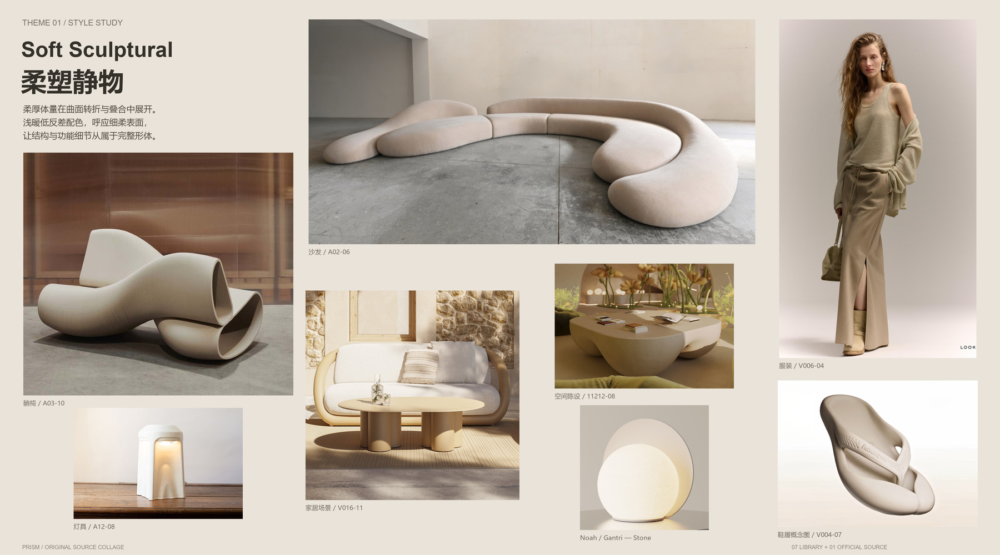
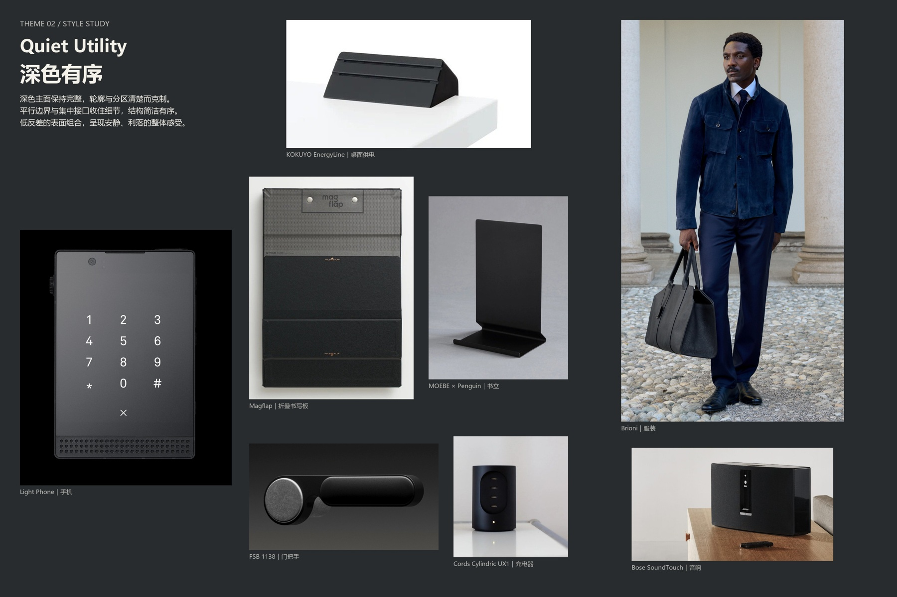
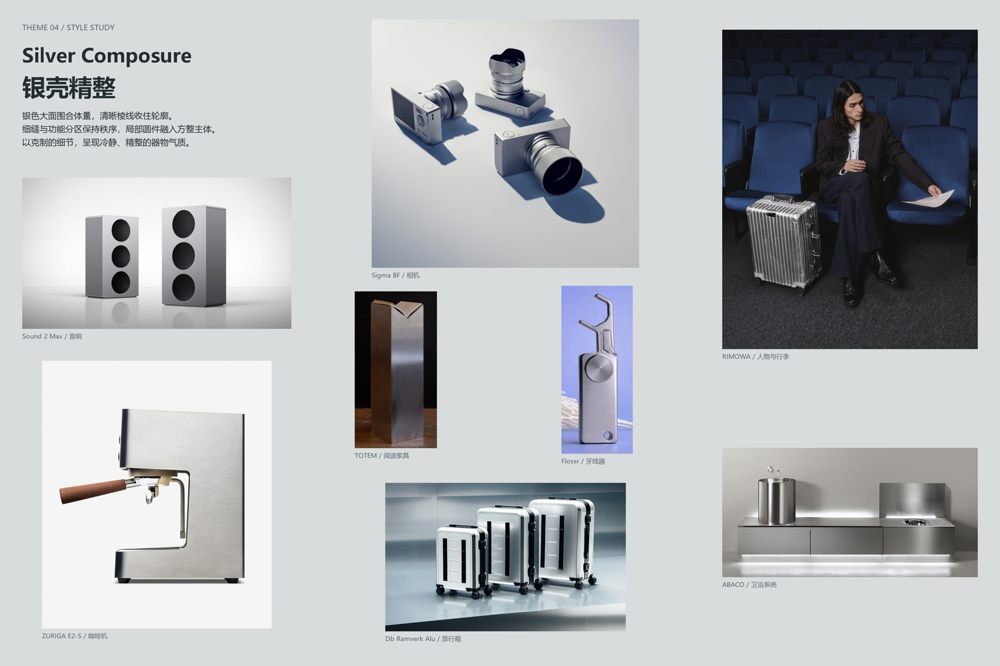
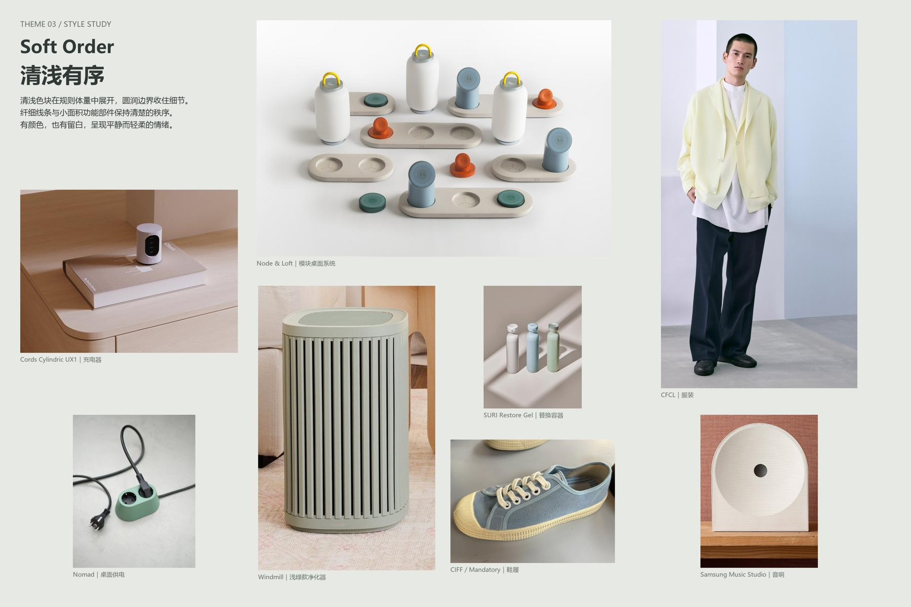
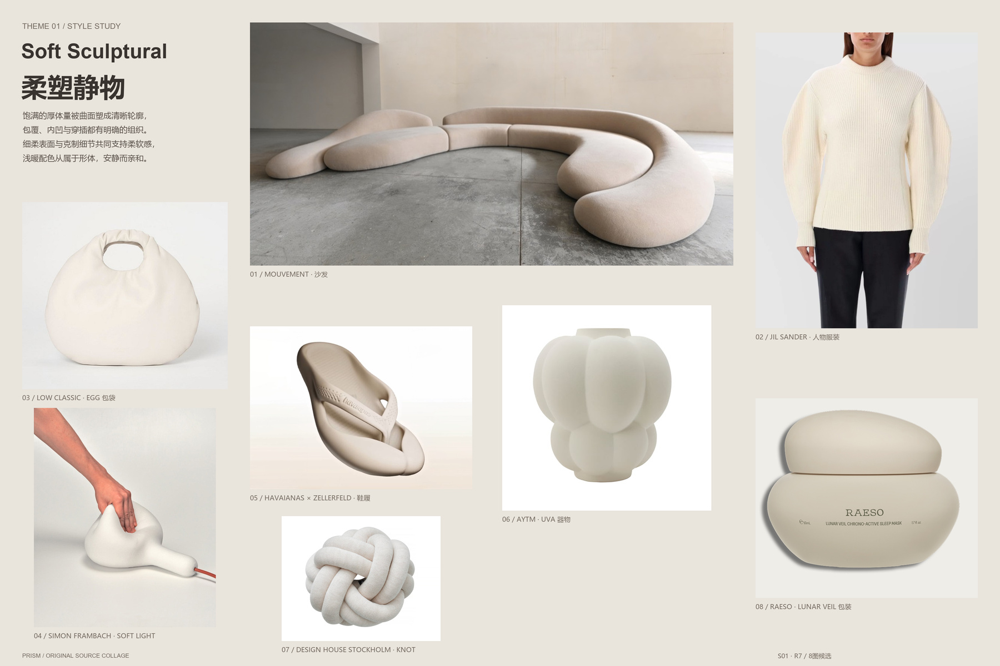

# 当前风格板版本预览

这些是已有输出的原预览字节，仅用于排版和版本识别；逐版判断见[case-status.json](case-status.json)。不可从预览代替完整原图审阅，也不可将其统一标为通过。

截图对应R4：设计师总体正面反馈，仍提到灯具局部边缘偏利；不是所有图片无条件通过。

深色有序R6：重要迭代候选；历史灯具形态杂乱和光哑问题须按具体版本重审。

银壳精整R11：迭代候选；方整实体与薄片/尖锐/整体圆润需持续区分，未记为设计师终审通过。

清浅有序R2：候选案例，不标新增真人验证。

柔塑静物R7：另一版本；不能继承针对R4的正面反馈。
