# 设计师参考板逐页视觉转译

原PDF只标G1—G14，不提供主题名。以下名称、主关系及解释把握均为AI逐图观察后的假设，不是作者标准。每页10图；编号顺序为上排左至右T01—T05，下排左至右T06—T10。

素材照片只能支持外观判断，不能证明基材、加工、耐久或受访者偏好。G13、G14不作强统一解释。

## G1｜深色细表面与精细边界（解释把握：较充分）

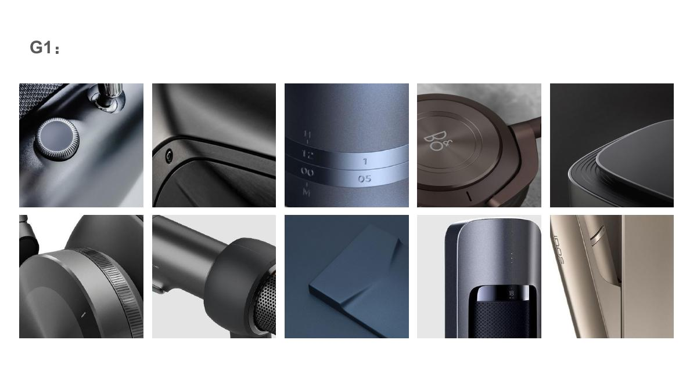

**主关系假设**：深灰、蓝灰等克制底色中的细微表面质感，与窄边框、细接缝或精细旋钮共同出现。

**必要可见证据**：主体表面较细；边界或控制件精细；整体色调克制。

**允许变化**：可以深浅变化、曲面或折面变化；不能要求全部黑色或全部同一种材料。

**最近似板区别**：G3更偏中性银灰与软硬搭配；G6强调深底与暖金属的明显搭配。

**边界与例外**：T08折面形态明显，但细微表面证据较弱；T10偏浅暖灰。

| 图位 | 实际可见外观记录 |
|---|---|
| T01 | 深色细颗粒机身旁有带细齿的圆形旋钮和窄亮边 |
| T02 | 深色圆角壳体的接缝与螺钉可见，表面反光柔和 |
| T03 | 蓝灰柱面有两道窄金属外观环带和细字 |
| T04 | 深棕圆形耳罩中有凹面与同心边界 |
| T05 | 深色圆角平面边缘有细密套叠槽线 |
| T06 | 灰色耳罩搭配银色圆环和细齿边 |
| T07 | 深灰弯曲机身与细孔网出风口相邻 |
| T08 | 蓝灰折面形成明暗面，细纹理不突出 |
| T09 | 蓝黑柱体的细表面与深色网状窗口相邻 |
| T10 | 浅香槟灰曲面机身旁有细窄控制接缝 |

## G2｜镜面外观与连续表面（解释把握：较充分）

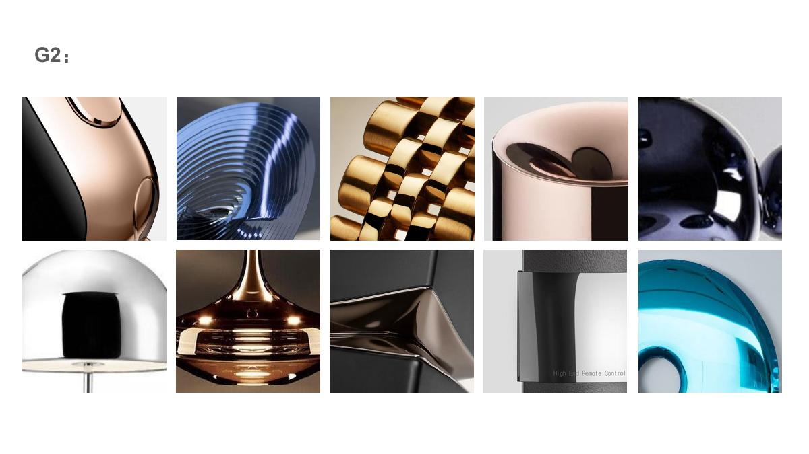

**主关系假设**：抛光镜面外观附着于可辨认的壳体、边缘或折面，呈现清晰映像与连续反射。

**必要可见证据**：高反射外观有实体边界；映像或高光结构沿表面延续；可辨认表面组织。

**允许变化**：银、金、蓝、黑等色相可以变化；曲面与折面都出现；配件可有低反射部分。

**最近似板区别**：G4是有色不透明壳体与宽高光；不能只因画面很亮就归入G2。

**边界与例外**：T03部分面较柔和；T08含折面；T09同时包含非镜面的深色表面。

| 图位 | 实际可见外观记录 |
|---|---|
| T01 | 玫瑰金外观的弯曲亮面与黑色部件相接 |
| T02 | 蓝色高反射弯曲件带起伏肋线 |
| T03 | 金色环带和链状结构各面反射强弱不同 |
| T04 | 暖色金属外观杯口内外反射明显 |
| T05 | 黑蓝色鼓起曲面产生清晰连续反射 |
| T06 | 银色穹顶上能辨认黑色矩形映像 |
| T07 | 暖金色细杆与曲面件映像明显 |
| T08 | 黑银高反射折面形成锐利边界 |
| T09 | 银黑亮面条形部件旁有深色细纹面 |
| T10 | 青绿色圆角亮面边缘呈现镜面映像 |

## G3｜中性银灰的细表面与软硬组合（解释把握：较充分）

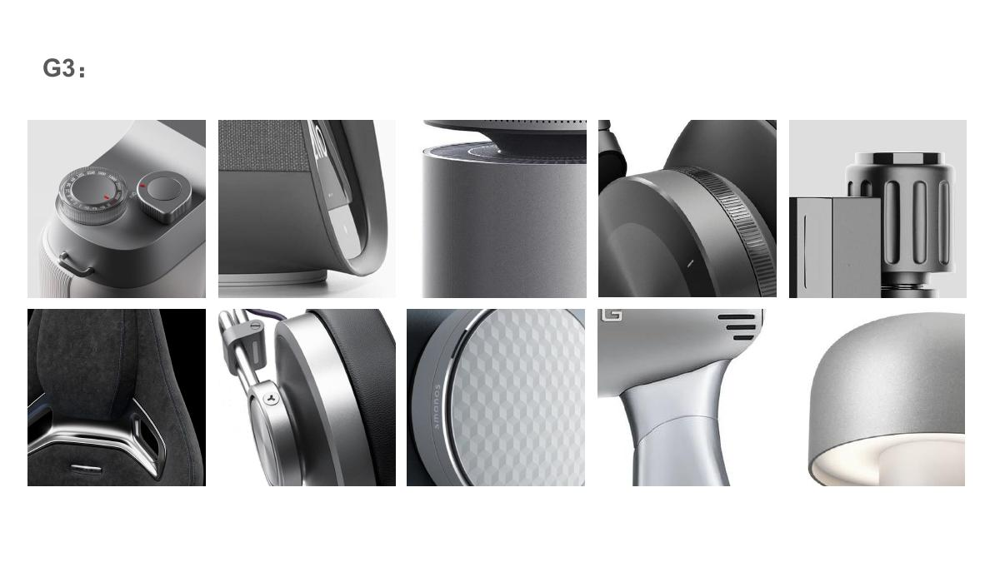

**主关系假设**：银灰、中性灰的细哑光或缎面外观，以精细硬质边界配合局部织物、软垫或网面。

**必要可见证据**：银灰或中性灰为主要外观；表面细而反射较柔和；精细结构边界可见。

**允许变化**：并非每张都有软材；允许局部亮边、纹理或暗色软材；不等于全金属。

**最近似板区别**：G1主色更深；G2镜面反射更强；G5浅暖底色和暖金属边界更突出。

**边界与例外**：T04与G1-T06相同；T08与G5-T08相同，说明原板并非互斥分类。

| 图位 | 实际可见外观记录 |
|---|---|
| T01 | 银灰相机外观机身带精细圆形控制件 |
| T02 | 灰织物网面与灰色硬壳边框、底座相邻 |
| T03 | 银灰柱面低反射细表面旁有窄亮边 |
| T04 | 灰耳罩和银色圆环、细齿边共同出现 |
| T05 | 灰色细沟槽柱体旁有矩形块面 |
| T06 | 黑色软座面旁有抛光银色细杆边件 |
| T07 | 灰色织物软垫耳罩与银色圆环相接 |
| T08 | 银灰圆形面板由三角分区和细纹构成 |
| T09 | 银灰曲面手柄的连接边界与开孔可见 |
| T10 | 灰色穹顶表面呈柔和反射 |

## G4｜有色光亮壳体与大曲面（解释把握：较充分）

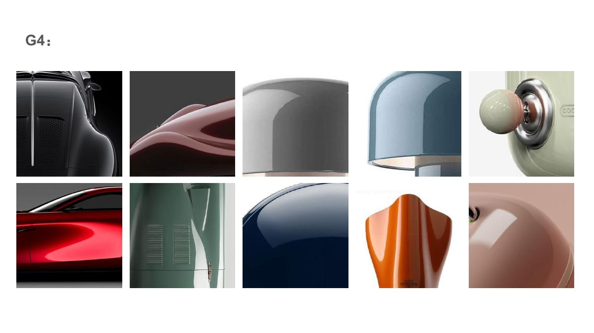

**主关系假设**：有色、不透明的光亮壳体，通过宽而连贯的高光显出平滑大曲面。

**必要可见证据**：主体颜色附着在壳体上；光亮外观和宽高光可见；平滑曲面有连续边界。

**允许变化**：深浅色、不同色相可以变化；允许局部镀亮边件与开孔。

**最近似板区别**：G2更强调镜面映像；G9更偏柔和低反射表面；不能按亮暗照片分组。

**边界与例外**：T01黑色且含通风细节，不能要求全板都是彩色或无开孔。

| 图位 | 实际可见外观记录 |
|---|---|
| T01 | 黑色汽车后部光亮曲面旁有竖向银条和通风结构 |
| T02 | 深红流动曲面与凹部形成宽高光 |
| T03 | 灰色光亮穹顶上有宽而平滑的高光 |
| T04 | 淡蓝穹顶光亮边缘呈连续曲率 |
| T05 | 薄荷色曲面壳体搭配亮边与浅色旋钮 |
| T06 | 红色汽车侧面呈现连贯光亮曲面 |
| T07 | 绿色壳体与细通风槽共同出现 |
| T08 | 深蓝鼓起壳体显示平滑光亮表面 |
| T09 | 橙色折转曲面壳体呈宽白高光 |
| T10 | 浅粉曲面壳体呈柔和的光亮高光 |

## G5｜浅暖主体与暖金属边界（解释把握：部分）

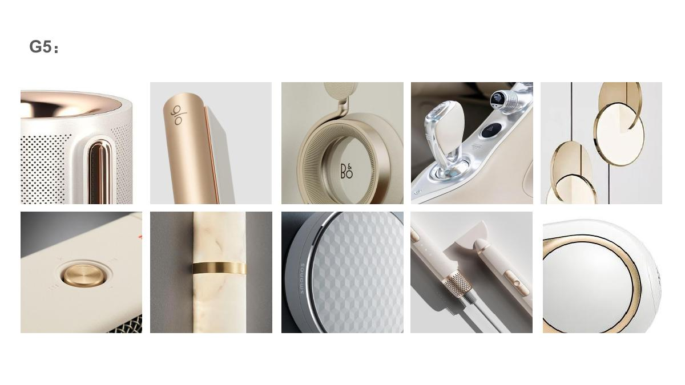

**主关系假设**：白、象牙、奶油色等浅暖主体，与金、香槟或玫瑰金外观的小边框、环带、按钮相接。

**必要可见证据**：浅暖主体与暖金属外观搭配同时可见；连接、边界或功能件的关系清楚。

**允许变化**：主体可平滑、细纹、开孔或石纹；暖金属可以做环、边、旋钮；不要求全哑光。

**最近似板区别**：G6是深色主体加暖金属；G3为中性银灰；只选白色表面会丢失本板关系。

**边界与例外**：T04亮面更偏银色；T05金色圆环没有清楚的浅暖主体；T08是较中性的银灰分区面板。因此该关系是主要子方向，不能声称十张都满足浅暖主体＋暖金属的必要条件。

| 图位 | 实际可见外观记录 |
|---|---|
| T01 | 象牙色开孔机身与玫瑰金外观嵌件和圆角按钮相接 |
| T02 | 香槟色窄长边件旁有浅色主体 |
| T03 | 奶油色耳罩带密集径向细肋与暖色边圈 |
| T04 | 浅色内饰中有亮面操纵件和控制界面 |
| T05 | 浅金色圆环边件围出细窄边界 |
| T06 | 象牙色平面内嵌暖金色圆按钮 |
| T07 | 浅石纹外观柱体搭配金色环带 |
| T08 | 银灰三角分区圆面板与细边共同出现 |
| T09 | 浅米色曲面手柄配暖金属外观细齿环带与按钮 |
| T10 | 白色圆面旁有细窄暖金色环边 |

## G6｜深色主体与暖金属边界（解释把握：较充分）

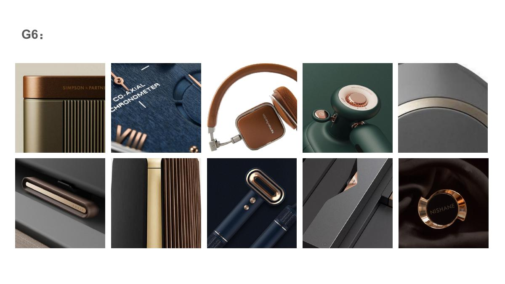

**主关系假设**：黑、深蓝、深绿或深棕主体，以铜金外观的细圈、嵌件、按钮或结构边件建立深浅与冷暖关系。

**必要可见证据**：深色主体与暖金属外观同时可见；两者的邻接位置和主次关系清晰。

**允许变化**：软材、硬壳、肋面或折面均可；不同色相允许变化；不要求全黑或全皮革。

**最近似板区别**：G5是浅暖主体；G1为较克制的深色精细表面，暖色搭配并不突出。

**边界与例外**：T07暖金色肋柱占比大，不能把暖金属面积固定为极小比例。

| 图位 | 实际可见外观记录 |
|---|---|
| T01 | 深橄榄肋面主体配铜色外观端盖 |
| T02 | 深蓝细纹表盘旁有铜色刻度与细齿环 |
| T03 | 棕色软垫耳罩与暖金属外观边圈相接 |
| T04 | 深绿圆角机身上有暖铜色圆按钮 |
| T05 | 深色弯曲面内有暖金色弧线嵌件 |
| T06 | 黑色主体内嵌窄长暖金属外观滑动件 |
| T07 | 金色竖肋柱旁有深铜色条状面 |
| T08 | 深蓝机身配暖铜色圆角控制件和细纹握面 |
| T09 | 黑色折面相交处露出暖金属外观边件 |
| T10 | 黑色瓶体或盖件配暖金色细环 |

## G7｜织物或木纹与硬质边件的连接（解释把握：较充分）

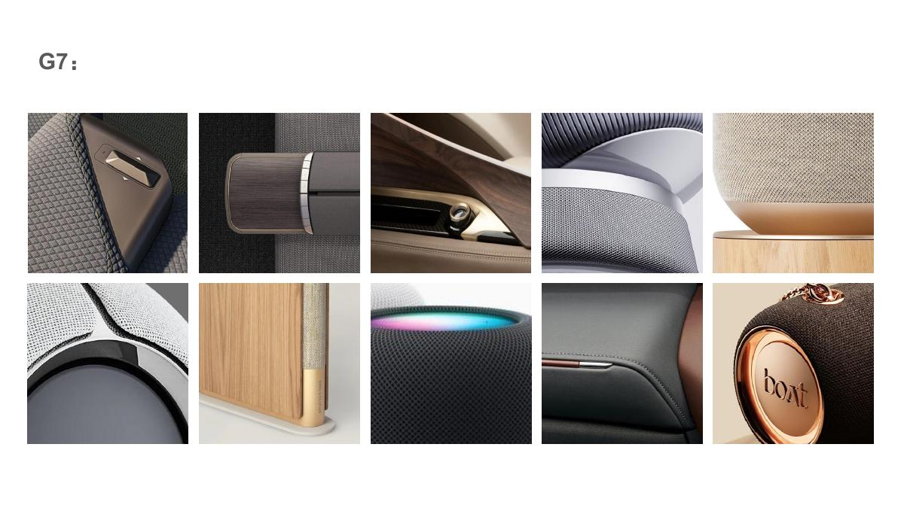

**主关系假设**：织物、皮革外观或木纹等有触感的表面，与硬质边框、金属外观控制件或支撑件在同一物件上相接。

**必要可见证据**：有触感的纹理可见；硬质边件可见；两者如何连接可见。

**允许变化**：可以织物、皮革外观或木纹为主；硬质部分颜色可变化；核心是邻接与连接关系。

**最近似板区别**：G3更强调中性银灰；G12更强调细密硬质装饰；单独布样或单独木纹不足以复现G7。

**边界与例外**：T08有发光边圈，但主关系仍是网面与硬边；真实材料名称需外部来源验证。

| 图位 | 实际可见外观记录 |
|---|---|
| T01 | 灰色织纹或软座面配硬质深色面板和圆形金属外观按钮 |
| T02 | 深灰织物旁有深木纹矩形面板及窄边件 |
| T03 | 木纹内饰配黑条、金色旋钮与棕色缝线软面 |
| T04 | 灰织物耳垫配银色硬框和细肋带 |
| T05 | 象牙色细织面配铜色底座及木纹支撑 |
| T06 | 白色针织外观罩面与黑色圆角硬壳相接 |
| T07 | 浅木纹面旁有织物带与金色柱形件 |
| T08 | 深色网面柱体围绕有色发光边圈 |
| T09 | 深色皮革外观面有接缝、缝线与细暖色边 |
| T10 | 棕色细织圆面与暖金色镜面圆面相接 |

## G8｜局部强色与功能界面（解释把握：较充分）

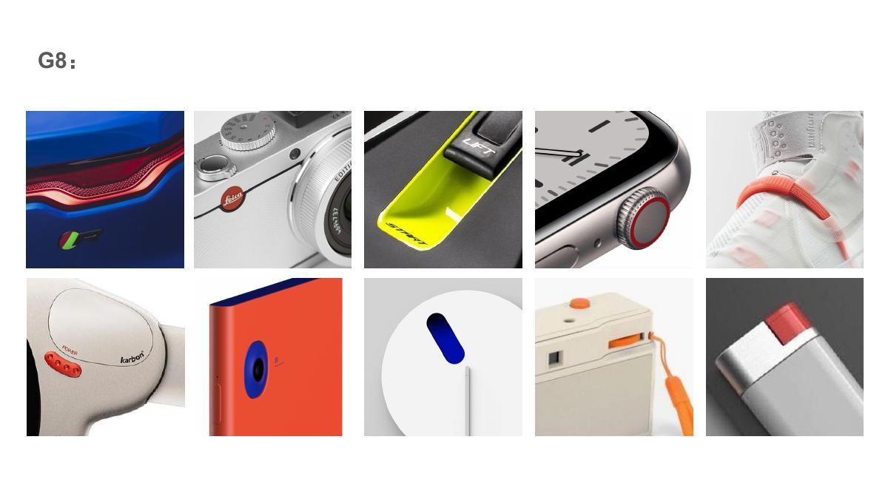

**主关系假设**：明显对比色落在按钮、冠钮、挂环、凹位、端件等局部位置，位置关系使色彩成为设计线索。

**必要可见证据**：对比色位置明确；与主体或功能件的关系可见；局部色与背景有可辨主次。

**允许变化**：色相可变；主色不限白灰；局部形状可变；不规定统一面积百分比。

**最近似板区别**：G10更多由较大有色主体和触感材质建立整体感受；单看红色或橙色无法区分。

**边界与例外**：T07橙色主体面积大，T01蓝色主体也强；局部强色是主要趋势而非十张全满足的定律。

| 图位 | 实际可见外观记录 |
|---|---|
| T01 | 蓝色车身上有红色尾灯条和小色标 |
| T02 | 银灰机身上有小红圆标 |
| T03 | 黑框内有荧光黄绿挂环或凹位 |
| T04 | 灰色表壳的细齿冠钮带红色细环 |
| T05 | 白色主体上有珊瑚色带或绳 |
| T06 | 奶油色圆角壳体上有红色按钮群 |
| T07 | 较大橙色主体与深蓝圆形嵌件对比 |
| T08 | 白色球面或平面体中有深蓝胶囊形凹位 |
| T09 | 象牙色盒体上有橙色按钮、凹位和绳件 |
| T10 | 灰白小件的端部有红色标签或端件 |

## G9｜柔和色彩与细哑光或缎面（解释把握：较充分）

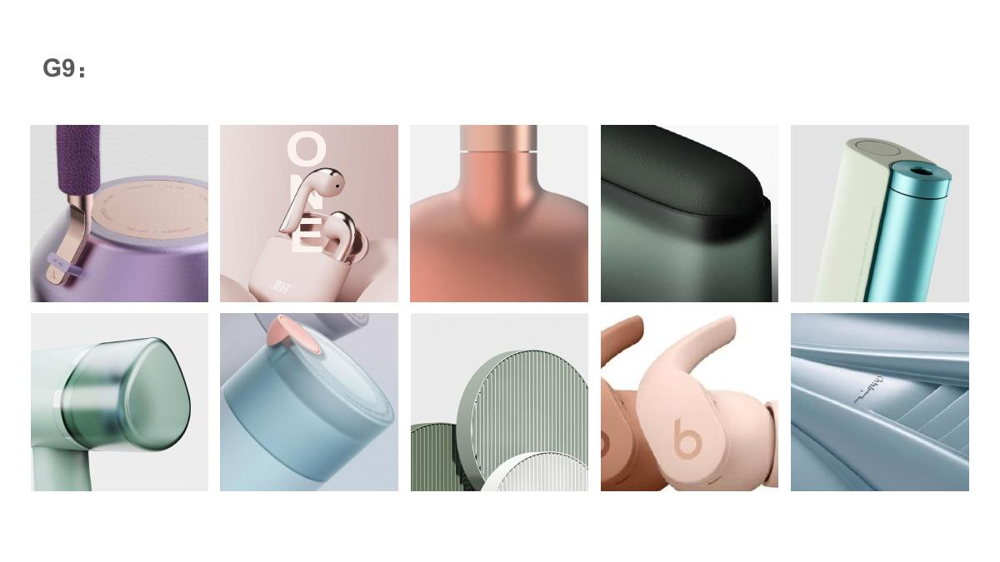

**主关系假设**：较柔和的彩色细表面配合平滑圆角形体，反射通常柔和，部分图有薄环、细肋或软垫。

**必要可见证据**：颜色及细表面在主体上可见；反射以柔和宽变化为主；圆角或曲面边界清楚。

**允许变化**：可深可浅，包含深绿和局部较强青色；允许缎面、小亮边和细纹，不能要求全部粉彩塑料。

**最近似板区别**：G4更光亮，G10整体颜色与触感对比更强；单独圆形无法构成该CMF家族。

**边界与例外**：T04明显更深；T05有强青色；T06透明感与反射性质不完全明确。

| 图位 | 实际可见外观记录 |
|---|---|
| T01 | 淡紫柱体与紫色织纹握面、香槟色顶盘组合 |
| T02 | 浅粉耳塞与盒体有平滑曲面和细金属外观边 |
| T03 | 蜜桃色细表面曲线瓶体中有窄连接环 |
| T04 | 深柔和绿圆角壳体有细颗粒表面 |
| T05 | 象牙色与较饱和青色柱体相邻 |
| T06 | 淡绿色圆柱面带一定透光或亮面外观 |
| T07 | 柔和蓝主体上有浅粉圆形控制件 |
| T08 | 灰绿细平行沟槽圆面配白色边圈 |
| T09 | 蜜桃色耳罩硬壳配浅粉软垫 |
| T10 | 银蓝折转肋面呈宽而较柔和的反射 |

## G10｜较强有色主体与触感组合（解释把握：部分）

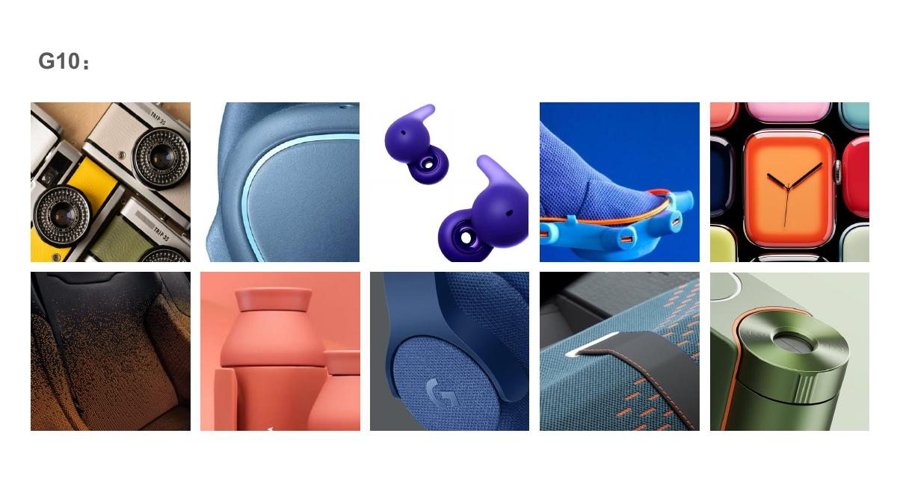

**主关系假设**：较强的主体色与织物、细颗粒、皮革外观等触感表面或对比色边界结合，呈较活跃的整体色材关系。

**必要可见证据**：主体有色与触感或边界的组合可见；需要用选定子方向进一步约束主次。

**允许变化**：不同色相、织物或细哑光外观都出现；不要把全板直接定义为蓝色运动风。

**最近似板区别**：G8更偏色彩在局部功能件上的位置；G9通常更柔和；实际交界需要逐图判断。

**边界与例外**：T06色调偏深且有斑点；T10有强亮面；总体相似感有依据，但不宜直接冻结为单一工艺。

| 图位 | 实际可见外观记录 |
|---|---|
| T01 | 奶油色相机外观主体有黑镜头与黄色矩形件 |
| T02 | 蓝色皮革外观面有浅青色细边 |
| T03 | 紫色圆润耳塞呈细哑光外观 |
| T04 | 蓝织物或针织鞋面配橙边与青色框 |
| T05 | 有色圆角表体以橙色较突出 |
| T06 | 深棕黑细颗粒面中有暖色斑点变化 |
| T07 | 珊瑚色圆润叠合壳体呈细哑光 |
| T08 | 蓝织物圆耳罩与有色硬边相接 |
| T09 | 蓝色织纹内饰配铜色边与缝线 |
| T10 | 绿色光亮柱体配暖珊瑚色环带 |

## G11｜光谱色与表面层次（解释把握：较充分）

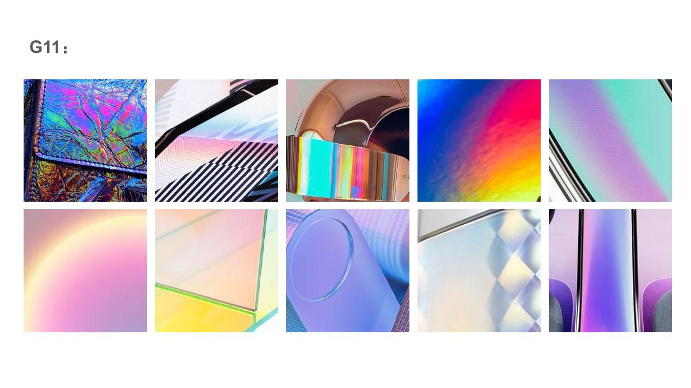

**主关系假设**：多色光谱、虹彩或渐变外观，与薄膜、曲面、折面或透明层的可见边界发生关系。

**必要可见证据**：多色变化附着于可辨表面或边界；色彩变化具有连续或分区组织；排除单纯背景彩灯。

**允许变化**：允许柔和或饱和光谱色，也可起皱、平面、曲面；真实虹彩工艺不能由静态照片确定。

**最近似板区别**：G13强调透视后层、厚度或漫透层；G11强调光谱色；两类可在同图共存。

**边界与例外**：T04、T06缺少明确物件边界，只支持色彩感受，不能独立证明可迁移的表面工艺。

| 图位 | 实际可见外观记录 |
|---|---|
| T01 | 黑框内的皱褶薄片外观带虹彩色 |
| T02 | 黑色条框下的分区面呈光谱色 |
| T03 | 金铜色圆顶件上有虹彩反射带 |
| T04 | 蓝紫黄连续渐变，物件边界不清 |
| T05 | 青紫渐变的细网格平面旁有黑边 |
| T06 | 柔和彩虹色弧形光带，表面边界不清 |
| T07 | 透明淡绿面旁有粉黄层次和边缘 |
| T08 | 紫色圆形凹位周围有虹彩线色 |
| T09 | 半透明三角折面中有淡色折射外观 |
| T10 | 紫蓝渐变柱体的接缝旁有软织面 |

## G12｜细密硬质装饰与精细边缘（解释把握：较充分）

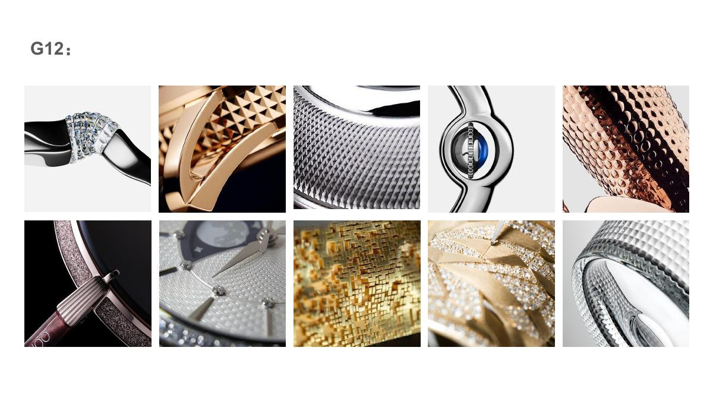

**主关系假设**：细密重复凹凸、切面、珠粒或刻纹外观，与精细硬质边缘搭配，形成接近饰品的装饰密度。

**必要可见证据**：细小重复装饰可辨；它与部件或边缘的组织可见；硬质或闪亮表面外观有依据。

**允许变化**：可菱形、金字塔、点状、细刻纹；颜色和局部形状可变；不是统一槽距或全部闪粉。

**最近似板区别**：G7是软织纹、木纹与硬边连接；G12强调硬质细装饰；亮点密集本身不等于同一种材料。

**边界与例外**：T06颗粒、反光与细肋并存；T09像粒状枝形，不能统一命名为同一种加工。

| 图位 | 实际可见外观记录 |
|---|---|
| T01 | 黑色曲面外观件配银色切面边带 |
| T02 | 金色圆边内有细金字塔突起带 |
| T03 | 银色密集人字或菱形浮纹配亮边 |
| T04 | 黑银曲线外框内有蓝色小面与细珠圈 |
| T05 | 铜色曲面有细小凹点或起伏 |
| T06 | 紫色细闪粒面旁有金属外观细肋部件 |
| T07 | 圆表面有细密重复刻纹外观 |
| T08 | 金色面由细小矩形拼块状纹理组成 |
| T09 | 金色颗粒或晶体外观边缘呈枝状结构 |
| T10 | 银色圆环上有密集金字塔状起伏 |

## G13｜透光层、漫透感与柔和光学表面（解释把握：有限）

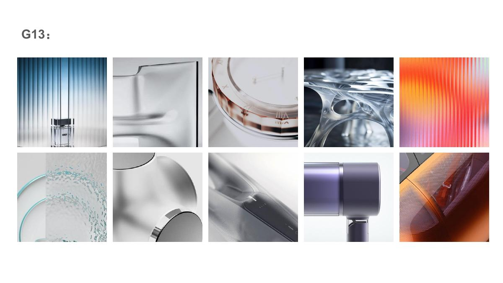

**主关系假设**：部分图明确表现透明或漫透层的厚度与后层关系，部分图更像不透明缎面；目前不能给十张同一透明材料定义。

**必要可见证据**：透明子方向必须能看见后层、透过纹理或透明边缘；不透明柔反射子方向需要另行定义。

**允许变化**：透明、漫透与细肋可以组合，但不应把柔和高光视为透明证据。

**最近似板区别**：G11以光谱色为主；G13中的透光证据来自前后层关系，而非彩光或宽高光。

**边界与例外**：T07银色曲面与T09紫色壳体缺少明确透光证据；T10层次性质不确定。此板暂不当单一家族验收模板。

| 图位 | 实际可见外观记录 |
|---|---|
| T01 | 竖向透明或漫透肋层前后有蓝背景与瓶体层次 |
| T02 | 透明或半透明成形面有柔化后层和边缘 |
| T03 | 透明表壳厚度与后方标记可见 |
| T04 | 透明网孔状成形件后方背景可见 |
| T05 | 细竖肋让橙粉颜色产生模糊层次 |
| T06 | 透明纹理面后方有青色物件 |
| T07 | 银色圆角表面有宽柔反射，透明性未证实 |
| T08 | 模糊半透明斜面后方有斜向硬件轮廓 |
| T09 | 紫色细缎面外观壳体，透明性未证实 |
| T10 | 铜橙点阵与多层壳体关系可见，是否透光不确定 |

## G14｜多种异质纹理与装饰表面探索（解释把握：有限）

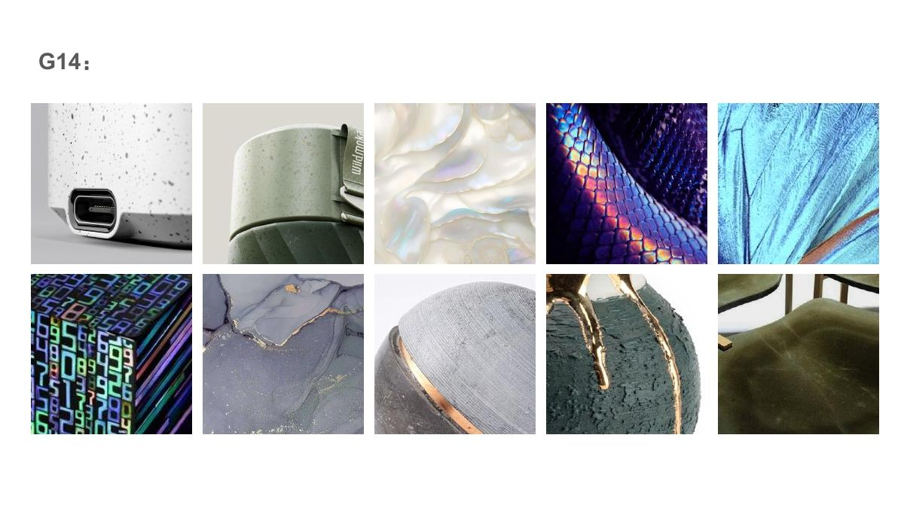

**主关系假设**：斑点、层纹、纤维、织网、石纹、裂隙与绒面并存，可确认它在探索表面表达，但不能确认统一触感或统一工艺。

**必要可见证据**：若生成新板，应先从中选择一条明确可见子关系，再检查素材容量与板间差别。

**允许变化**：作为探索参考允许异质材料；作为当前访谈板须按具体子关系重新定义。

**最近似板区别**：不要用自然、环保、高级等词兜住整板；这些不是由全部照片共同支持的视觉事实。

**边界与例外**：十张的纹理类型和反射不同；按一个纹理词强行通过会掩盖内部差异。

| 图位 | 实际可见外观记录 |
|---|---|
| T01 | 灰白表面有分散黑点，旁有圆角接口或部件 |
| T02 | 柔和绿柱体有细斑点和接缝 |
| T03 | 奶油色珠光外观面有波浪层纹 |
| T04 | 紫色鳞片状重复切面带虹彩色 |
| T05 | 青色皱褶纤维外观面有方向变化 |
| T06 | 蓝紫虹彩织网外观立方体 |
| T07 | 灰紫脉络表面中有细暖金色裂隙线 |
| T08 | 灰色织物圆软面配金色边和石纹面 |
| T09 | 深绿粗糙面中有金色脉络条 |
| T10 | 橄榄色绒面软垫随绒向产生明暗变化 |
