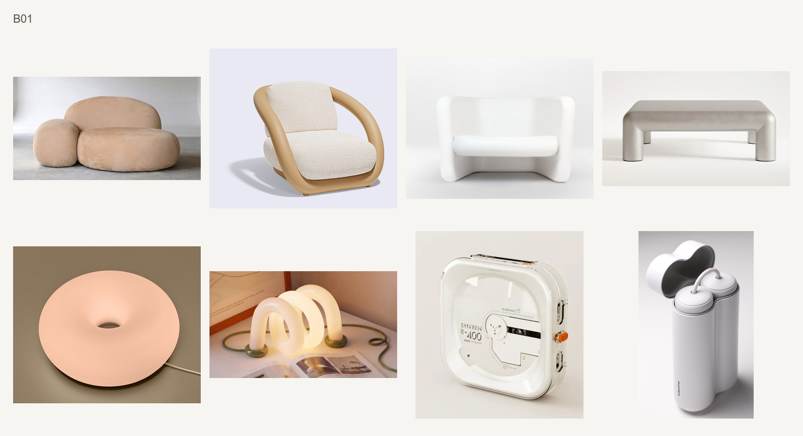

# 选图与整板复核

本页的局部关系判断仍适用于元素／CMF任务。总体风格任务须先使用[风格层规则](style-level-review.md)，同时保存元素支持与总体风格判断；局部CMF通过不能替代完整设计语言成立。

针对“共同维度太少、其他维度放得太开”的反馈，总体风格复核同时使用[多维关系与配色收敛](multidimensional-style-review.md)。配色和纹理按该页细分；原图可见事实、共同关系与冲突分别记录，不用宽标签或自动分数代替整板判断。

## 将参考变成可执行家族

先看实际参考图，不先读主题名猜图。选最有把握的可见关系，回到其余图检查是否支持，记录例外；不把每页十张想象成十个完美正例。参考中的局部差异需按视觉权重和整体情绪判断，不能自动当作其他弱图的通行证，也不能将它升级成所有图片所有维度必须相同的标准。最新容差与反例见[设计师反馈校准](designer-calibration.md)。

每个方向记录以下内容：

| 字段 | 需要写清的内容 |
|---|---|
| 模式和范围 | ID、CMF或联合；whole_object、surface或same_object_interface |
| 本轮目标 | 重建参考主要关系，或用参考校准后另建方向；二者不能共用通过结论 |
| 主关系 | 一句可在照片中指认的关系；不是情绪形容词 |
| 设计情绪假设 | 整体感受及形态、比例、色彩、材料外观、光泽纹理、细节语言的可见依据；不代表用户偏好 |
| 必要证据 | 在哪些位置看得到什么；哪些条件不可缺 |
| 可变化项 | 色相、品类、形体、纹理等哪些变化不影响主关系 |
| 干扰与排除 | 哪种材质感、形态或取景会压过主关系 |
| 邻近方向 | 最容易混淆的板及可见区别 |
| 取景原则 | 必须保留的边缘、层次、部件或全貌；预计介质、展示宽度、审阅倍率；条件未定标注待校准 |
| 证据等级 | 实际观察、AI解释、用户确认、未核实材料事实 |
| 容量与缺口 | 实际达到条件的来源数；未知项目身份；还缺什么 |

不设未经校准的自动分数阈值。图谱中的“较充分／部分／有限”表示AI对视觉解释的把握，不是设计师评分或统计置信度。

## 三个真正不同的判断

**逐图支持**：去掉标题与原文章，在当前取景中指出必要证据。若一张图只能靠“看起来也挺柔和”加入，证据不足。裁切可消除背景，但不能裁掉支持关系的接缝或改变物件感。

**整板一致**：以最终缩放看一遍，再逐张对照。检查形态与比例、主色关系、表面外观、相邻部件、纹理尺度与细节语言组合后是否指向相近的设计情绪。一张图可符合形态词，却因色材、比例、表面和细节的共同变化把整体感受拉偏。不能把不一致归因于单一材料，也不能按不同维度的数量自动判退。

先描述可见组合，再写情绪解释。例如“浅暖主体、鼓起软面、大圆角、隐蔽接缝”可以支持亲和松弛的判断；“中性银灰硬面、较紧的体块比例、精细亮边、锐利窄接缝”可以支持冷静精密的判断。这些只是推理示例，不是固定材料与情绪的对应表。若两图共用圆角，却在其余组合上各自指向不同感受，不能用圆角共性兜住整板。反之，软织面与银色硬框也可协同传达精致、克制的同一方向，需看实际比例与连接细节。

ID和CMF的比较范围仍分别声明。CMF局部板的情绪判断只能依据保留的表面与接口，不能从局部推断未见整机的整体设计情绪。照片的背景、照明和道具若主导情绪，标为摄影干扰，优先换取景或换图。

**板间区分与启发**：同时看最近似两板，遮掉标题。应能在图中指出实际不同的设计关系，并说明它能迁移到哪种设计处理。不是要求受访者学会说专业术语；内部解释应能由照片直接支持。

这三个判断分别记录，不能用“8张已齐／来源足够”推导视觉通过。尚未经过受访者选择验证时，只能叫候选刺激，不声称已验证访谈有效性。

## 参考中的实质对照

- **G5与G6**：主趋势都是暖金属搭配，主体多为浅暖或深色。只收集金色按钮会把两板合并。取景保留按钮周围足够主体。G5-T04更偏银色亮面，T05没有明确浅暖主体，T08偏中性银灰；严格重建“浅暖主体＋暖金属”时是在重建主要子方向，不能声称整个G5十张都满足。
- **G8与G10**：都能出现红、蓝、橙。G8较多将强色放在局部功能件上；G10多由较大有色主体、触感与对比边界组织感受。G8-T07、G10-T10提示两者并非绝对互斥，边界例外需写出。
- **G2与G4**：镜面映像与光亮有色壳体的宽高光不同。只按亮度、色彩相近聚类会混淆两者。不能凭照片断言镀层或真实基材。
- **G7**：木纹或织物不是唯一条件；接缝、框架、金属外观边件等邻接关系使其具有设计启发。只裁出一块布纹会丢掉这部分。
- **G11与G13**：光谱色不等于透明，柔和反射也不等于透光。G13-T07、T09不作为透明正例。
- **G14**：这是异质纹理探索参考。若在新库做访谈板，先定义斑点、层纹或“有色脉络与金属外观细线”等具体子关系；不把“特殊材料”作为万能家族。

## 当前B01反馈的应用范围

用户在上一张整机试验板后指出：“整机风格其实更难统一，不同材质带来的感觉是不一样的”。[反馈记录](user-feedback.json)绑定该板文件哈希。

用户随后转述设计师补充：“问题不是仅仅出在了不同材料，而是这两个不同材料同时加上别的维度不一致后，两个产品的设计情绪相差太大。”这是用户转述的设计师反馈，不冒充本系统直接采访记录。

可执行修正：不能以“都有圆角／鼓起体块”直接判ID整板通过；要逐图看形态比例、色彩、材料外观、光泽纹理和细节组织怎样共同形成设计情绪。材料差异不是单独否决项，多个维度的差异也不必然失败；判断其组合是否协调、是否让整体感受发生明显分离。G7的多材质关系说明不同材料也能共同建立一致方向。

## 处理与输出

可按已授权范围进行裁切、等比缩放及必要原图恢复。访谈材料避免通过改色、造纹理或生成部件制造一致性；若用户明确要求概念生成，独立标为生成概念，不混计真实照片来源。

对每张实际候选保存pool_id、original_ref(path+sha256)、article_id及已知project_id、comparison_scope、ROI范围、必要证据、confounders、decision、reason和view_ref。总体风格记录增加多维可见关系、相对代表图的支持／偏离和整体情绪判断；相关项看不清时标记未知，不能当作一致。未知来源不能编造；转载文章不同也不能证明项目不同。

成板记录主关系、规则版本、实际张数、已知独立来源情况、逐图判断、整板判断、差异最大的一对及其关系、最近似板区别和board_ref(path+sha256)。review_kind标明作者自审、独立模型复核或用户反馈；后两者也不能冒充设计师认可。

判断条件在正式候选评审前固定。失败后可以改关系或换图，但形成新版本并重审；不可改完规则继续引用旧PASS。
