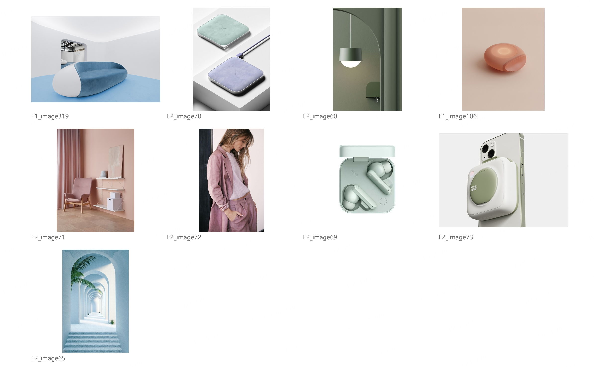
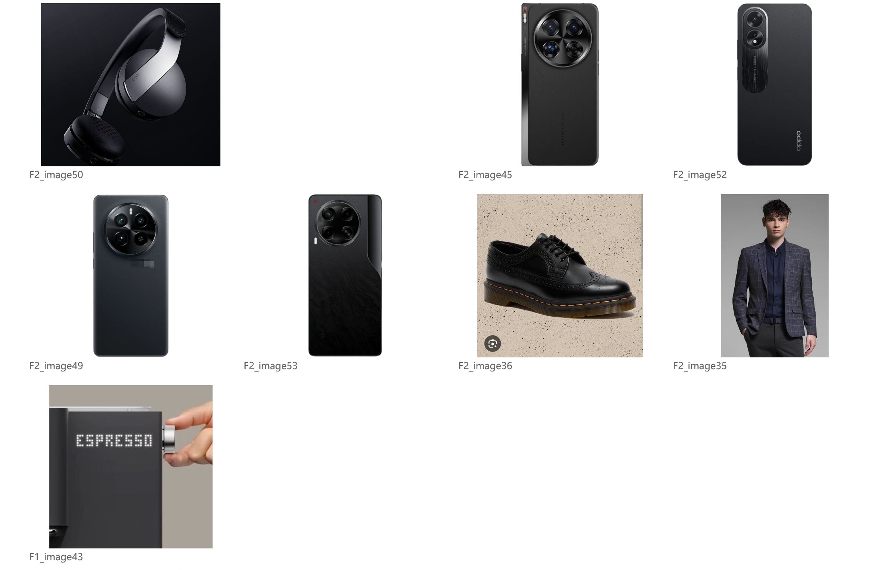
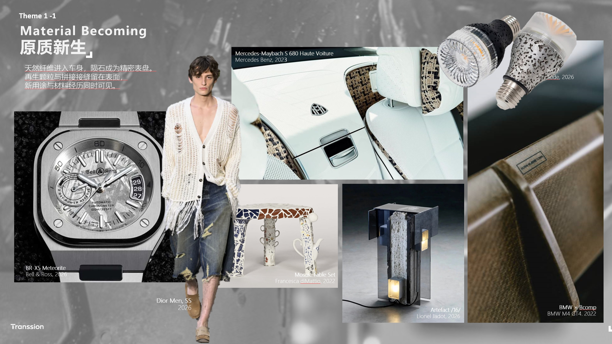

# 总体风格层：三张设计师标准板

依据：2026-10-10用户直接提供三张标准板，并转述设计师说：“风格版需要说明同一种设计语言，在不同品类上的成立性。我们研究的是总体风格，跨品类不是硬性的死要求，但是用于总体风格的研究时候跨品类的价值比较大。”

用户要求当前任务由元素层进入风格层，成板精致程度参照第三张。以下主题解释和可见规则是AI转译；不冒充设计师原始命名或逐图认可。原图与SHA见[证据记录](style-reference-evidence.json)。参考中的产品名称、时间、材料及再生用途仅为附件标注，未在本任务中独立核验。

## 参考一：柔和形体与低对比色材共同成立

实际可见：沙发有大圆弧的包围轮廓，充电板为薄圆角方体，耳机盒与手机配件有柔化的边缘；浅蓝、薄荷、粉紫和粉暖色多为低对比搭配；织物与细柔表面的变化协同。灯具仍有较明确的几何截面，室内细腿家具也不是统一鼓起体块。

风格假设：**简洁、柔化的体块与低对比色材组织，共同形成轻柔、亲和的日常产品感。** 不能仅以“都是粉彩”判同风格，也不能声称全板都是鹅卵石形态。服装和空间提供相近情绪的旁证；产品是否支持完整设计语言需单独检查。

迁移检查：换到另一品类，是否仍能通过体块边缘、厚薄比例、表面反射与配色主次表达这套语言，而非只涂相同颜色。

## 参考二：深色主体中的受控精细表达

实际可见：耳机、手机与咖啡机以深色主体为主，较完整的块面承载集中而清楚的功能区域，局部光亮圈、金属外观边件或控制件建立边界；西装强调有秩序的轮廓及较细纹理。鞋子的厚底、装饰孔与暖色缝线是更重的表达，不能解释成全部产品共享同一几何细节。

风格假设：**深色完整体块配合集中功能区域和精细边界，形成克制、稳重的表达。** 暂称解释，不把“商务”视为已确认的用户偏好。黑色户外粗重装备、夸张电竞尖角或裸露复杂机械，不能仅凭深色加入。

边界：多张手机仍是同一品类的重复证据；跨品类价值由耳机、咖啡机等实际不同设计对象提供。服装和鞋可以帮助表达总体感受，但不能替代产品上的语言成立性。

## 参考三：材料痕迹进入经过组织的产品

实际可见：表盘的不规则纹路被完整外框和精密刻度组织；浅色座椅与内饰中有织物面及清楚的包边、分区；灯具、桌腿或面板出现颗粒、拼接或纤维外观，与明确的产品结构相接；服装以松散织孔、流苏和磨损痕迹提供材料经历感的旁证。图中并非所有纹理、配色或体块一致。

风格假设：**把可见的不规则材料痕迹保留在经过整理的产品形体里，用结构、分区及边界赋予秩序。** 这可用于解释该板“原质新生”的视觉组织。图片可支持颗粒、纤维或拼接外观，不能证明再生材料、天然基材、陨石来源、环保性能或生产工艺。主题文字可以表达设计师提案，但不能作为新选图的视觉证据。

它的精致度还有独立的呈现依据：重点产品有明确视觉权重，整机或场景与表面特写互相支撑，大图与小图形成主次，人物及灯具轮廓有层次，标签位置和版面边界经过组织。灰色纹理背景帮助组织情绪，却不能拿来给所有新板套统一背景，或制造素材原本没有的一致性。

不要把第三张转译为“收集粗糙材料样片”或“将所有照片排成复杂拼贴”；也不要求新风格必须研究原质新生。

## 选图之前：写出整套语言

记录一个可复核的风格假设，而非增加情绪形容词：

- **组织方式**：体块、厚薄、轮廓、曲面转折及构造如何组织；哪些形态变化仍相容。
- **色材表面**：主体与配件的主次、对比、光泽和纹理尺度如何配合；不是只列色卡与材料名。
- **细节语言**：接缝、开孔、边框、按钮和连接结构如何支持整体；并非每张都必须有同一种细节。
- **设计情绪**：以上组合共同传达的感受，绑定具体可见证据；哪些组合会拉向最近似的另一方向。
- **跨品类成立性**：不同对象各自怎样实现同一套语言。记录实际覆盖及差异；不设置品类硬配额，也不把形式照抄当作迁移。

具体收敛方法使用[多维关系与配色收敛](multidimensional-style-review.md)。先把“圆润／多彩／粗颗粒”等宽标签拆成照片可直接支持的关系；明确共同支撑的组合、可容纳变化与会拉偏情绪的变化。不能用增加形容词或机械增加相同维度数量替代风格判断。

表面逻辑可以主导某个风格，但仍须看它如何进入完整产品及其整体感受；不能将“只看局部CMF”作为风格层通过的捷径。允许细节图，保留足够信息判断它与产品的关系。

## 逐图与整板复核

先判断产品本身，再判断摄影是否扭曲观察。同色背景、相似光线、统一修图不证明产品语言相同。衣服、秀场、建筑和艺术作品可作为直接支持同一语言的素材，不按来源一刀切；只有氛围相近而没有设计关系时，不计作产品语言证据，也不为补足8张加入。

逐图说明它支持的是完整语言、某一语言维度还是仅氛围。新风格板不能主要靠氛围图或匿名特写成立；多维组合必须在产品图中看得见。不要用未经校准的分数或“不一致维度个数”自动判退。

整板审阅分别记录：

1. 不读标题，每张保留的产品是否属于相近的语言和设计情绪；发现元素相同、整体相差很大的图就替换。
2. 跨品类时，语言是否仍可在不同对象上指认；同品类板只声明本品类覆盖，不冒充普遍成立。
3. 拿掉任一弱匹配图是否更收敛；若剔除后不足8张，放弃该板，不能靠排版补回来。
4. 遮掉文字和装饰背景，是否仍能与邻近方向区分。取景只能去掉摄影干扰，不隐藏反例。
5. 产品迁移价值：能指导未来产品的形体组织、部件关系和CMF组合，而非只推荐某个按钮、金属圈或一块纹理。

复核包括最强代表图与各候选的对照，以及整板中差异最大的一对；逐次相似形成的链条不能证明整组收敛。收到新负例后重审该方向全部候选，不只替换被点名图片，也不默认其余图获认可。

元素层成立但风格层失败时，记录`element_supported / style_not_established`，保留为素材证据；不能给旧板改名后升级结论。作者自审仍是候选，不能称为设计师认可或访谈已验证。

## 最终呈现：精致度独立审阅

从已成立的素材组设计版面。用主图引导整体感受，以支持图展示语言在其他对象上的变化；图像大小随证据重要性变化。不要无理由等大铺满，不硬规定主图数量、品类数或全貌与细节比例。

统一对齐、间距、视觉重心和照片尺度，保持关键表面在输出尺寸下清楚。裁切保留支持语言的体块、边缘和接口；涉及抠图时保持原对象完整、透明边缘干净，不能重绘部件、改色或合成假实物。未授权生成时不用生成素材补库。

图片叠压不得挡住必需证据。背景只做辅助，不能把纤维、颗粒或品牌气氛伪装成产品的共同属性。参考第三张的呈现完成度，不复制其中编辑标记、品牌标识或产品事实。

输出纯图片审阅／访谈版，并可提供主题、语言说明与真实来源标签的设计师沟通版。内部审阅先看纯图片版；沟通版文字不能引导或替代访谈选择。两版素材保持一致并各存文件哈希。

每板仍需至少8张独立来源图。同一图多次裁切、抠出的同一对象、纹理背景、参考板及图上附加装饰都不增加张数。
